

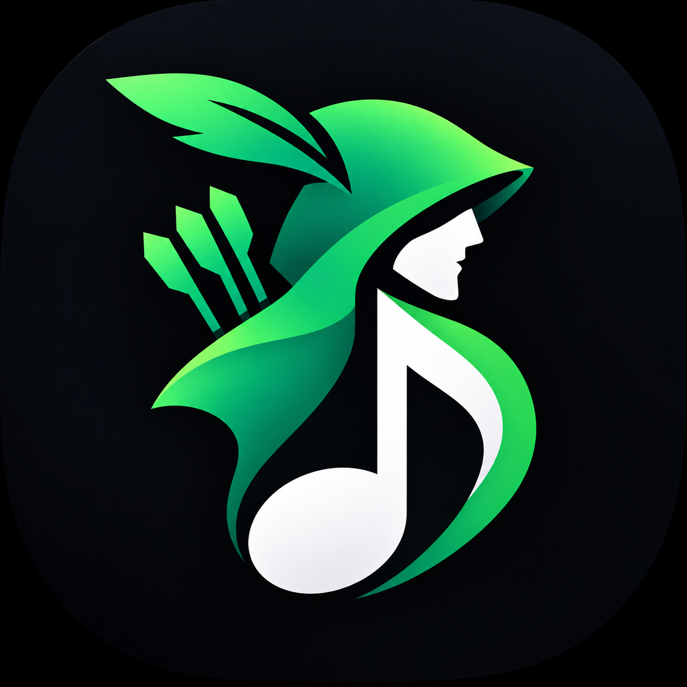

# RobinHood

**An open-source YouTube Music client for Android**

Stream music, manage your library, enjoy synced lyrics, and customize your listening experience.

[Download](#download) · [Features](#features) · [Screenshots](#screenshots) · [Translations](#translations)

## About

RobinHood is an independent, open-source music streaming app for Android that uses YouTube Music as its music source. Built with Kotlin and Jetpack Compose, it combines music discovery, background playback, offline downloads, synced lyrics, and library management in a customizable interface.

> **Regional availability:** If YouTube Music is unavailable in your region, a VPN or proxy connecting to a supported region may be required.

## Screenshots

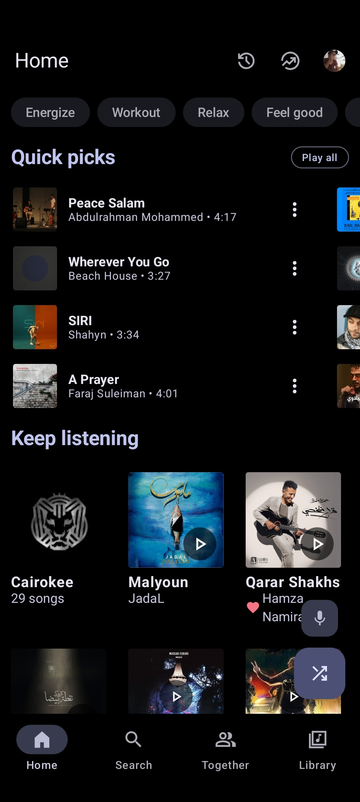
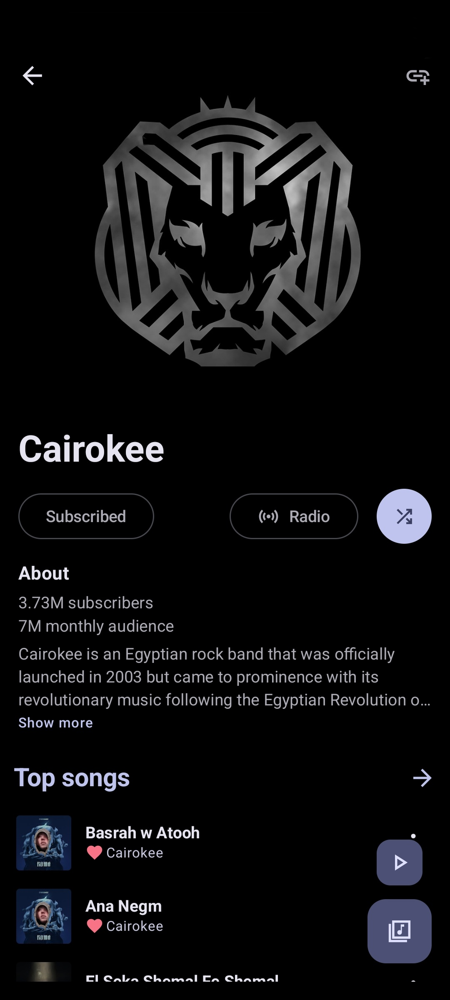
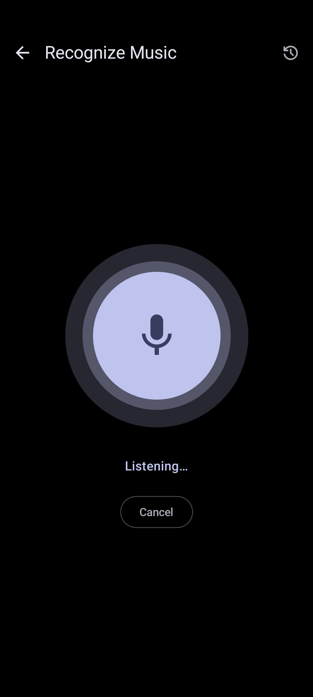
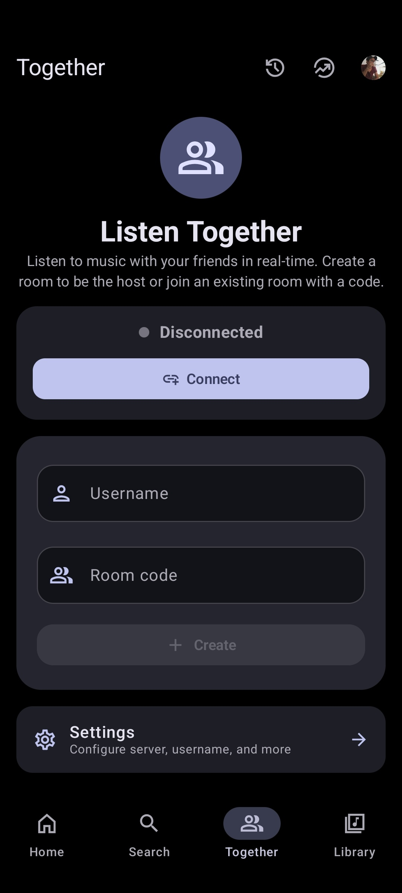
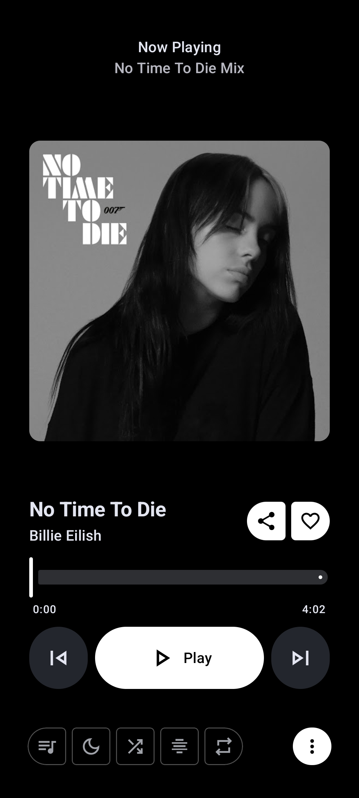
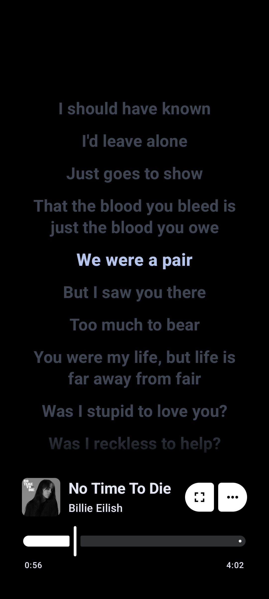

## Features

| Category | Features |
| --- | --- |
| **Playback** | YouTube Music streaming, background playback, offline downloads and caching, skip silence, sleep timer |
| **Audio** | Equalizer, audio normalization, tempo and pitch control, crossfade |
| **Lyrics & discovery** | Synced lyrics, lyrics translation, quick picks, search for songs, albums, artists, videos and playlists |
| **Library** | Local playlists, playlist import, queue management, YouTube Music account sync |
| **Social** | Listen together, Last.fm scrobbling, Discord Rich Presence |
| **Interface** | Home screen widget, Material 3, dynamic colors, light, dark, black and dynamic themes |

## Download

### Stable release

| Obtainium | IzzyOnDroid |
| --- | --- |
| [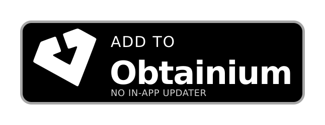](https://apps.obtainium.imranr.dev/redirect?r=obtainium://add/https://github.com/Faroffcode/robinHood/) | [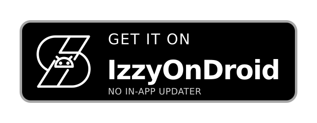](https://github.com/Faroffcode/robinHood/releases) |
| OpenAPK | GitHub |
| [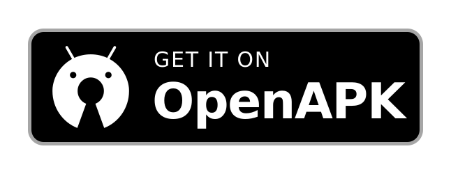](https://github.com/Faroffcode/robinHood/releases) | [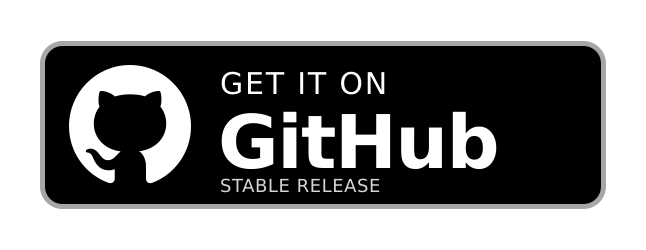](https://github.com/Faroffcode/robinHood/releases/latest/download/RobinHood.apk) |

### Nightly build

[Download the nightly build with Google Cast](https://github.com/Faroffcode/robinHood/releases/download/nightly/RobinHood-with-Google-Cast.apk)

See [all releases](https://github.com/Faroffcode/robinHood/releases).

## Translations

RobinHood translations are managed through Weblate. [Help translate the app](https://hosted.weblate.org/projects/RobinHood/).

## Acknowledgements

RobinHood is inspired by [InnerTune](https://github.com/z-huang) and [OuterTune](https://github.com/DD3Boh).

Thanks to the projects and contributors behind [Better Lyrics](https://better-lyrics.boidu.dev), [metroserver](https://github.com/Faroffcode/metroserver), [MusicRecognizer](https://github.com/aleksey-saenko/MusicRecognizer), [zemer-cipher](https://github.com/ZemerTeam/zemer-cipher), and the open-source community.

## Disclaimer

RobinHood is an independent project and is not affiliated with, endorsed by, or associated with YouTube, Google LLC, or their affiliates. All trademarks and other intellectual property belong to their respective owners.

---

**Made with ❤️ by Imtiaz Haque**

